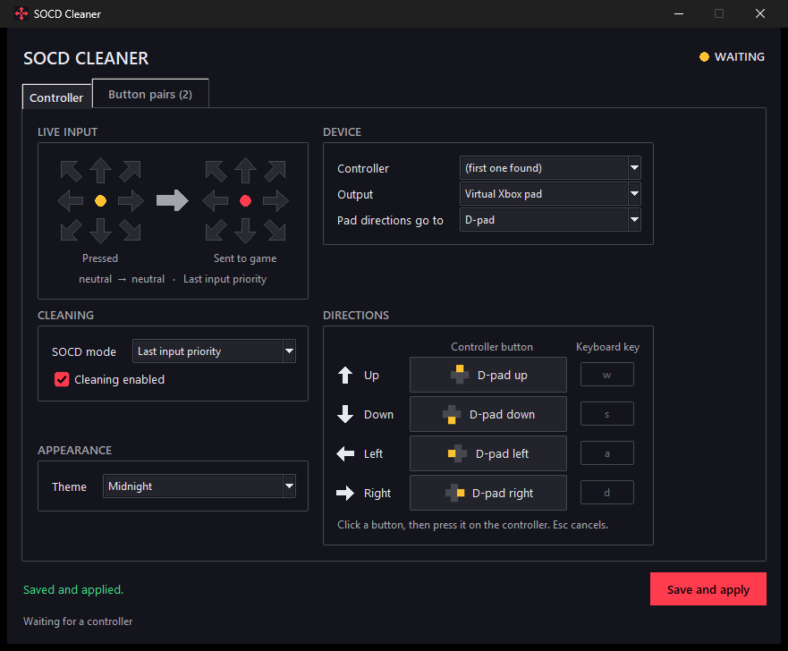

# SOCD

SOCD cleaner for any controller, inspired by [hitboxer](https://github.com/valignatev/hitboxer)
(which does the same for keyboards).

Map any four buttons of any controller (XInput, DirectInput, PlayStation, Switch, generic HID —
anything SDL recognises) as Up / Down / Left / Right. Opposing presses are resolved and sent to
the game as either a virtual Xbox 360 pad or keyboard keys.

| Mode | Left + Right | Up + Down |
|---|---|---|
| Last input priority | newest wins | newest wins |
| Last input, no re-press | newest wins; the other stays off until pressed again | same |
| First input priority | oldest wins | oldest wins |
| Neutral | nothing | nothing |
| Up priority | nothing | Up |

## Install

Download `socd.exe` from the latest run under **Actions → build → Artifacts**, or run from source:

```
set VGAMEPAD_SKIP_VIGEMBUS_INSTALL=true
pip install -r requirements.txt
python socd.py
```

**Keyboard output** needs nothing else.

**Virtual pad output** needs two drivers (admin rights to install):

1. [ViGEmBus](https://github.com/nefarius/ViGEmBus/releases) — provides the virtual Xbox pad.
2. [HidHide](https://github.com/nefarius/HidHide/releases) — hides your real controller from the
   game so it doesn't see every input twice. In *HidHide Configuration Client*: add `socd.exe`
   (or `python.exe`) under **Applications**, tick your controller under **Devices**, and enable
   **device hiding**.

## Use



It lives in the system tray; double-click the icon for settings (shown automatically on first run).

- **Live input** — two fighting-game notation grids show what you hold and what the game receives,
  so you can check a mode without opening a game.
- **Controller** — "(first one found)" or a specific one. SOCD's own virtual pad is left out of the list.
- **Directions** — click a direction's button, then press the controller button to bind it (Esc
  cancels). LT and RT can be bound too. Binding a button that another direction already uses swaps
  the two.
- The controller family (Xbox, PlayStation, Nintendo Switch) is detected from its name, and the
  buttons are shown with that family's names and glyphs (A/B/X/Y, cross/circle/square/triangle, L1/ZL ...).
  Unknown controllers, and PlayStation pads running through Steam Input or DS4Windows, show as Xbox.
- **Pad directions go to** — d-pad, left stick (full tilt), or both.
- **Keyboard key** — one character, or `up` `down` `left` `right` `space` `enter` `tab` `shift` `ctrl` `alt`.
- In pad mode every other button, stick and trigger passes straight through, and rumble from the
  game is forwarded to the real controller.

Tray menu (right-click): turn cleaning on/off, switch SOCD mode, start with Windows, quit. Mode and
on/off changes apply instantly without unplugging the virtual pad. With cleaning off, pad mode
mirrors the real controller unchanged and keyboard mode sends nothing.

The tray tooltip shows the current status, and a notification appears when the controller connects,
disconnects (it reconnects by itself) or the virtual pad can't be created.

Settings are saved to `socd_config.json` next to the program; a damaged file is ignored and
defaults are used. If SDL doesn't recognise an obscure controller, drop a
[`gamecontrollerdb.txt`](https://github.com/mdqinc/SDL_GameControllerDB) next to it.

## Limits

- Stick directions can't be bound as directions, only buttons and triggers.
- Two identical controllers can't be told apart (matched by name).
- Keyboard output can't reach a game running as administrator unless SOCD is also run as administrator.
- Many games and tournaments restrict SOCD modes (e.g. last-input-priority); check the rules.

## Button pairs

The **Button pairs** tab does for any two buttons what the direction modes do for opposites, like
hitboxer's mappings. Add a pair, bind any two buttons (face buttons, shoulders, triggers, ...) and
pick the rule for when both are held:

| Rule | Both held |
|---|---|
| Last pressed wins | newest wins; releasing it brings the other back |
| Last pressed wins, no re-press | newest wins; the other stays off until pressed again |
| First pressed wins | oldest wins |
| Both cancel out | neither is sent |
| Button 1 always wins | Button 1 |

Up to 8 pairs. A button can be in one pair or one direction only. With pad output the winner is
sent as that same button; with keyboard output give each button a key (empty = send nothing).
Paddles, touchpad and misc buttons have no Xbox 360 equivalent, so in a pair they only work with
keyboard output.

## Themes

**Appearance → Theme** switches the look instantly, without interrupting the controller:
Midnight (default), Daylight, Kazuya, Heihachi, Bryan, Fahkumram and Reina. The character themes are
original colour palettes named after who inspired them; no game artwork is used. Every theme is
checked by the tests for readable contrast.

`socd.exe --show` opens the settings window at start instead of staying in the tray.

## Design

Dark theme with one accent colour, text contrast of at least 4.5:1, an 8 px spacing grid, visible
keyboard focus, and state shown by shape or words as well as colour (filled vs outlined arrows,
"RUNNING" next to the status dot). All icons are drawn by the program itself; no game artwork is used.

## Test

```
python test_socd.py
```
